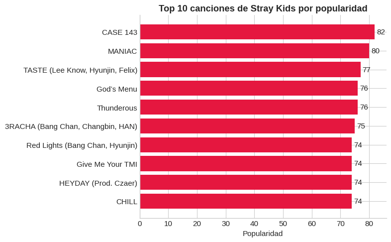
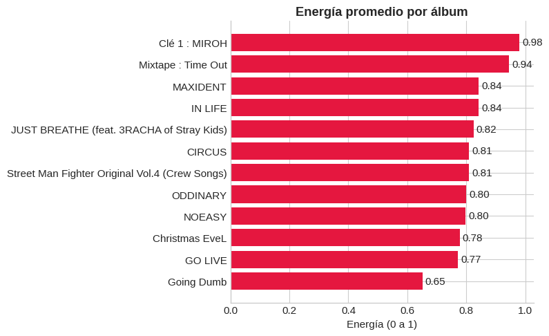
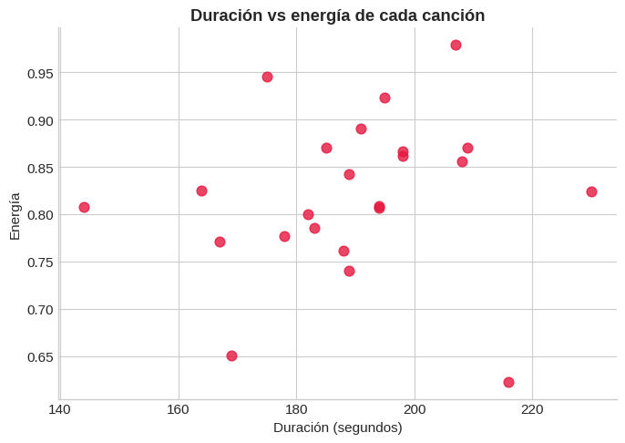

# SKZ Setlist

Proyecto de optimización que genera un setlist de Stray Kids utilizando el Problema de la Mochila, programación dinámica y datos obtenidos de Spotify.

## Visualizaciones

### Top 10 canciones más populares



### Energía promedio por álbum



### Relación entre duración y energía



## Descripción

El objetivo es seleccionar un conjunto de canciones que maximice una métrica de valor (popularidad, reproducciones u otra puntuación derivada de Spotify) sin superar una duración máxima de concierto.

Este proyecto aplica un algoritmo clásico de optimización para resolver un problema inspirado en la planificación de conciertos.

## Tecnologías utilizadas

- Python
- Jupyter Notebook
- Pandas
- Programación Dinámica
- Spotify Data

## Cómo ejecutar el proyecto

1. Clona el repositorio:

```bash
git clone https://github.com/OsirisRmz/skz-setlist.git
```

2. Accede al directorio:

```bash
cd skz-setlist
```

3. Abre el notebook:

```bash
jupyter notebook
```

4. Ejecuta `skz_setlist.ipynb`.

## Algoritmo

El problema se modela como una variante del Problema de la Mochila:

- Cada canción tiene una duración.
- Cada canción tiene una puntuación asociada.
- La duración máxima del concierto actúa como restricción.
- El algoritmo busca maximizar la puntuación total sin exceder el límite de tiempo.

## Ejemplo de salida

El algoritmo devuelve un conjunto optimizado de canciones para una duración determinada de concierto.

## Autor

Osiris Ramírez
